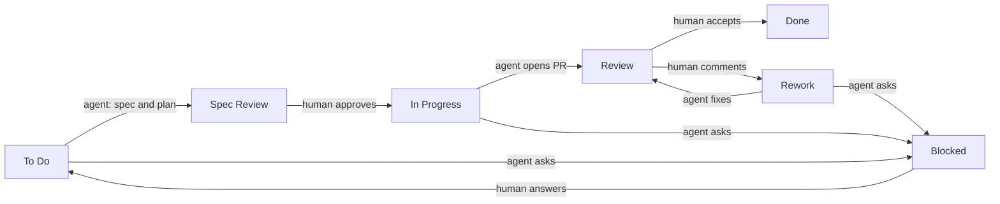

# tiny-symphony

A small daemon that takes tasks from a Backlog.md board, runs a coding agent CLI on each in its own
git worktree, checks the result and writes it back to the board. Cut down from
[OpenAI Symphony](https://github.com/openai/symphony) to one job.

## Stage

v0.1.0, a prototype for one user on one machine. Works and covered by tests: the polling loop with
bounded concurrency, worktree per task, result checks (a plan for To Do; for Review a clean tree, a
pushed branch, a PR or MR, the project's `verify` command), retries with backoff, Blocked after
`max_attempts`, stop when a human moves the card, a lock against a second daemon, cleanup of Done
worktrees and old logs, `check`. Only Backlog.md is supported as a tracker. Not done: a run under
launchd or systemd (the daemon runs in the foreground), opencode and pi are unverified, the config
is read at start only. See `docs/spec.md`, Left out and Open questions.

## Quick start

Needs Go 1.26, `git`, [Backlog.md](https://github.com/MrLesk/Backlog.md) 1.55 (`backlog`), `gh` or
`glab` for PRs, and an agent CLI from the table below.

1. Build: `git clone https://github.com/daniil4545/tiny-symphony && cd tiny-symphony && go install .`
   (the binary lands in `$(go env GOPATH)/bin`).
2. Config: copy `examples/config.toml` to `~/.config/tiny-symphony/config.toml` and the
   `examples/prompts/` folder next to it. Set `backlog_dir` (the folder that contains `backlog/`),
   `workspace_root`, one `[projects.<name>]` with the path of a git repo, and an agent command.
3. Board: the statuses must be To Do, Spec Review, In Progress, Review, Rework, Blocked, Done, and
   the `projects` list must contain the project name.
4. Check: `tiny-symphony check` prints one line per check and exits 1 on any FAIL. It starts no
   agent and writes nothing. It checks that the tracker answers, `workspace_root` is writable, at
   least one agent and one project exist, agent commands are on PATH and contain `{prompt}`, repos
   are git repos, the forge CLI is on PATH, and the prompts render.
5. Run: give a task the project and the label `agent:<name>` (for example `agent:claude`), then
   `tiny-symphony run --once` for one tick, or `tiny-symphony run` for the loop.

A To Do task goes to Spec Review with a plan, or to Blocked with a question. The agent writes
`.tiny-symphony/result.json` in its worktree; the contract is in `docs/spec.md`, Agent contract.

Tests and linter: `make test` (needs `git` and `backlog` on PATH) and `make lint`.

## Pipeline

Agents work in To Do, In Progress and Rework. The other statuses wait for a human. A task without an
`agent:<name>` label is never touched.

## Agents

An agent counts as supported only after a passing smoke run (`make smoke AGENT=<name>`, paid, needs
`PAID_OK=1 MAX_USD=1`).

| Agent | CLI version | Command | Smoke run |
| --- | --- | --- | --- |
| claude | 2.1.322 | `claude -p --permission-mode auto {prompt}` | passed 2026-11-11 |
| codex | 0.167.1 | `codex exec --sandbox workspace-write {prompt}` | passed 2026-11-11, 48 s |
| kimi | 2.5.2 | `kimi -p {prompt}` | passed 2026-11-11, 61 s |
| opencode | 2.2.6 | `opencode run --auto {prompt}` | not verified: API key expired |
| pi | 1.4.0 | `pi -p {prompt}` | not verified: no API key |

Any other CLI with a one-shot mode is a few lines in `[agents.<name>]`.

## Docs

| Question | Where |
| --- | --- |
| how it is built, where things are | `docs/architecture.md` |
| what it does, config, decisions | `docs/spec.md` |
| rules for agents working on this repo | `AGENTS.md` |
| what changed | `CHANGELOG.md`, `git log` |
| Symphony and agent CLI research | `docs/research/T-660-prior-art.md` |
| the original pipeline drawing | `docs/flow.drawio` |

MIT, see `LICENSE`.
