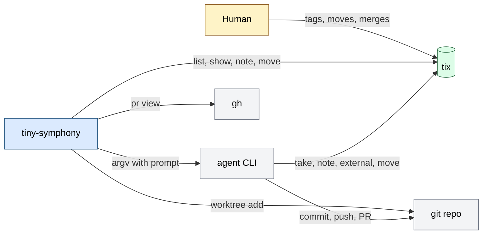

# tiny-symphony architecture

A foreground daemon (one process) that polls tix for tasks tagged `agent:<name>` in the watched
statuses and runs an agent CLI per task in a git worktree. The agent works with the tracker itself;
the daemon reads where the task ended up and writes only a note, a move to blocked or a move back.
Input: a config file (and a `.tiny-symphony.toml` per project) and the tracker. Output: worktrees
and run logs under `workspace_root`, rare tracker writes. State lives in the tracker; in memory
only running runs and retry times; attempt counts and watch marks are files in the worktree.
External calls: `tix`, `git`, `gh` (with the watch on), the agent CLI.

Why it is built so: `docs/spec.md` (Philosophy, Decisions). One task across all systems:
`docs/process.md`. Sections: 1 Map, 2 Main flow, 3 Processes, 4 Data and states, 5 External
systems, 6 Failures, 7 Observability, 9 Where to change.

## 1. Map

| File | Role |
| --- | --- |
| `main.go` | entry: `run` and `check`, flags, the lock, `runTask` (one run) and `judge` (the outcome from the tracker) |
| `loop.go` | scheduler `sched`: tick (reconcile, collect, dispatch), orphans, workers, workspace lock |
| `tix.go` | the tracker interface, the tix adapter, `TrackerTask` |
| `supervise.go` | attempts file, guarded `Note`/`Block`/`Reopen`, leftover agents |
| `agent.go` | starting the agent in its own process group, argv |
| `prompt.go` | the built-in prompt template |
| `workspace.go` | branch name, git worktree per task found by id, `.tiny-symphony/` kept out of git |
| `config.go` | TOML config, defaults, project layer, `~` expansion |
| `watch.go` | PR watch: `gh pr view`, notes, `Reopen`, marks file |
| `cleanup.go` | worktrees of closed tasks, old logs |
| `check.go` | `check` command: static checks of config and environment |

### Invariants

| Invariant | Where | Checked by |
| --- | --- | --- |
| No task without an `agent:<name>` tag is touched (R2) | `agentFor` in `loop.go` | `integration_test.go` |
| An agent starts only inside `workspace_root`, no shell (R1, R5) | `runAgent`, `argv` | `agent_test.go` |
| One daemon per `workspace_root` (R6) | `lockWorkspace` | `loop_test.go` |
| No merge, no push, no deletion of unmerged branches (R7) | `cleanup`, `watchPRs` | `cleanup_test.go`, `watch_test.go` |
| Tracker writes are `Note`, `Block`, `Reopen`, each after a guarding `Get` (R8) | `guarded` in `supervise.go` | `integration_test.go`, `watch_test.go` |
| Agent commands come only from the central config (R9) | `withProjectLayer` | `layers_test.go` |
| `check` writes and creates nothing | `check.go` runs before the lock | `check_test.go` |

## 2. Main flow

One tick, then one run of an `open` task.

| Step | Where | What |
| --- | --- | --- |
| 1 | `tick` | list tasks per watched status; a failed read skips the tick |
| 2 | `reconcile` | stop runs whose task lost the tag or was taken over |
| 3 | `recoverOrphans` | reopen tagged in_progress tasks with no run |
| 4 | `tick`, `ready` | pick tasks with a known agent and repository, no live claim, `After:` closed, below `max_agents`, out of backoff |
| 5 | `runTask` | reload the task; skip if tag or status changed; apply the project layer |
| 6 | `prepareWorkspace` | worktree on `T-<N>-<slug>`, or reuse the one found by id |
| 7 | `renderPrompt`, `runAgent` | strict template with the actor; agent runs with a timeout, log in `.tiny-symphony/` |
| 8 | `judge` | read the task again: handed over is success, otherwise a failed attempt with a guarded note and `Reopen` |
| 9 | `block` | after `max_attempts`: note, `Block`, count reset |

Housekeeping (`cleanup`, `watchPRs`) runs on the tick when its module is on. Failure at a step:
section 6. The rules are in `docs/spec.md` (Run).

## 3. Processes

| Process | Start | Cadence | What |
| --- | --- | --- | --- |
| `tiny-symphony run` | by hand or a supervisor | every `poll_seconds` | the loop; one goroutine owns scheduler state, one goroutine per run |
| `tiny-symphony run --once` | by hand | one tick | same, exits when its runs end |
| `tiny-symphony check` | by hand | once | static checks, no lock |

## 4. Data and states

| Entity | Source of truth | Changed by |
| --- | --- | --- |
| task, status, claim, notes, `external` | tix store | the agent, humans; the daemon only note, blocked, open |
| worktree and branch | git repo of the project | the daemon creates and removes; the agent commits and pushes |
| PR, CI, merge | GitHub | the agent opens the PR; a human merges |
| run log, pid file | `<worktree>/.tiny-symphony/` | the agent run |
| running runs, retry times | memory of `sched` | lost on restart by design |
| failed attempts, last reason | `<worktree>/.tiny-symphony/attempts` | the daemon; kept over restarts |
| watch marks (merged, closed, limit), reopens | `<worktree>/.tiny-symphony/watch` | the daemon |

Statuses are names from the config: watched ones (`watch`), `handoff_status`, `blocked_status`,
`reopen_status`.

## 5. External systems and boundaries

| System | Used for | Trust |
| --- | --- | --- |
| `tix` 0.8.1 | list, show, projects; note, move | fixed binary; every call has a timeout; the store comes from `TIX_HOME` |
| `git` | worktrees, branch cleanup | fixed binary |
| `gh` | `pr view`, with the watch on | fixed binary |
| agent CLI | does the work and writes the tracker | command from the central config; its output is only logged; the tracker decides success |

Task text becomes what the agent reads, so whoever writes tasks can run code (`docs/spec.md`, Left
out). The agent has write access to the tracker store, git and the network.

## 6. Failures and retries

| Failure | Result |
| --- | --- |
| agent crash, timeout, exit without handover | failed attempt, retry after 1, 5, 15 min with the reason in the prompt |
| run left the task taken, or a tagged in_progress task with no run | note, `Reopen`, failed attempt (our own claim: backoff step only) |
| `max_attempts` reached | note with reason and log path, `Block`, count reset |
| tag removed, task taken back or stolen | run killed, no attempt counted |
| a bad project `.tiny-symphony.toml` | failed attempt with the reason |
| tracker read error | tick skipped, runs left alone |
| the task changed before a daemon write | nothing is written |
| `gh` error | log line, next round |
| daemon crash | pid files find leftover agents on next start; attempt counts stay in the worktree |

## 7. Observability

`key=value` lines (`log/slog`) on stderr with `task` and `outcome`. Run logs of the agent:
`<workspace_root>/<branch>/.tiny-symphony/*.log`, deleted after `log_days`. Daemon notes in the
task name the log path. `check` for the environment. No metrics.

## 9. Where to change

| Change | File | Also |
| --- | --- | --- |
| a new agent | config only | add a `live_test.go` entry and a smoke run before calling it supported |
| the prompt | `prompt.go` | `prompt_test.go` |
| a project-layer key | `withProjectLayer` in `config.go` | spec Config, `layers_test.go` |
| a config field | `config.go` | `examples/config.toml`, spec Config |
| a new check in `check` | `check.go` | `check_test.go` |
| a new tracker | an adapter next to `tix.go` | spec Adapter contract |

## 10. Limits and open

One tracker (tix), one machine, no config reload. Reconcile sees our claim only on a tick (spec,
Supervision). Subscription limits are not told apart from other failures (spec Q2). Section 8 does
not apply: no environments; the config is in `docs/spec.md`, Config.
