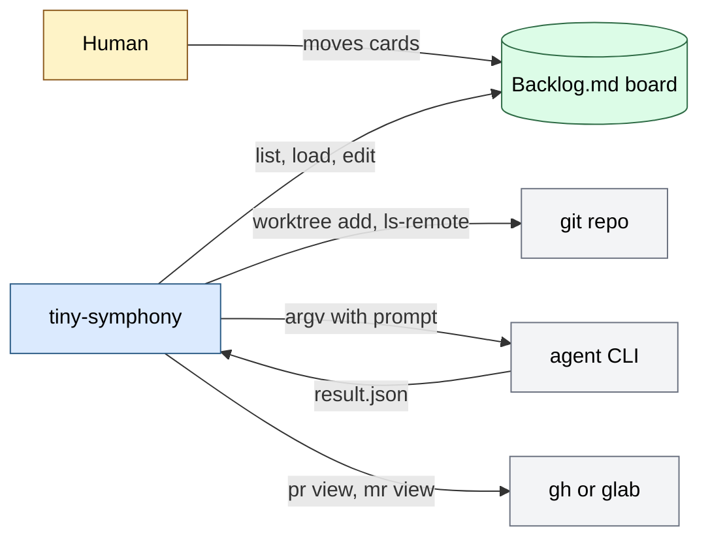

# tiny-symphony architecture

A foreground daemon (one process) that polls a Backlog.md board, runs an agent CLI per task in a git
worktree, checks the result and writes it to the board. Success is a task moved on by the daemon
with the agent's plan or summary in its fields. Input: a config file, prompt templates, the board.
Output: board edits, worktrees and run logs under `workspace_root`. State lives in the tracker;
in memory only running runs and attempt counts. External calls: `backlog`, `git`, `gh` or `glab`,
the agent CLI.

Why it is built so: `docs/spec.md` (Philosophy, Decisions). Sections: 1 Map, 2 Main flow, 3 Processes,
4 Data and states, 5 External systems, 6 Failures, 7 Observability, 9 Where to change.

## 1. Map

| File | Role |
| --- | --- |
| `main.go` | entry: `run` and `check`, flags, the lock, `runTask` (one run from workspace to tracker write) |
| `loop.go` | scheduler `sched`: tick (reconcile, collect, dispatch), workers, outcomes, workspace lock |
| `supervise.go` | result checks for Review (`checkWork`), retries and Blocked, leftover agents, Done cleanup |
| `tracker.go` | Backlog.md reader and writer, `Task` and `Result`, transition check |
| `agent.go` | prompt rendering, starting the agent in its own process group, reading `result.json` |
| `workspace.go` | branch name, git worktree per task, `.tiny-symphony/` kept out of git |
| `config.go` | TOML config, defaults, `~` expansion, names compared trimmed and lowercased |
| `check.go` | `check` command: static checks of config and environment |

### Invariants

| Invariant | Where | Checked by |
| --- | --- | --- |
| No task without an `agent:<name>` label is touched (R2) | `tick` in `loop.go` | `integration_test.go` |
| An agent starts only inside `workspace_root`, no shell (R1, R5) | `runAgent`, `argv` | `agent_test.go` |
| Only transitions of the pipeline table are applied (R3, R4) | `checkResult` | `integration_test.go`, `tracker_test.go`, `agent_test.go` |
| One daemon per `workspace_root` (R6) | `lockWorkspace` | `loop_test.go` |
| No merge, no push, no deletion of unmerged branches (R7) | `housekeeping` | `supervise_test.go` |
| `check` writes and creates nothing | `check.go` runs before the lock | `check_test.go` |

## 2. Main flow

One tick, then one run of a To Do task.

| Step | Where | What |
| --- | --- | --- |
| 1 | `tick` | list tasks; failed read skips the tick |
| 2 | `housekeeping` | remove Done worktrees, old logs |
| 3 | `tick` | stop runs whose card moved |
| 4 | `tick` | pick tasks with a known agent and project, below `max_agents`, out of backoff |
| 5 | `runTask` | reload the task; skip if label or status changed |
| 6 | `prepareWorkspace` | worktree on `T-<N>-<slug>`, or reuse |
| 7 | `renderPrompt`, `runAgent` | strict template; agent runs with a timeout, log in `.tiny-symphony/` |
| 8 | `readResult`, `checkResult` | result exists, transition allowed, plan present |
| 9 | `checkWork` | for Review: clean tree, pushed branch, PR or MR, `verify` |
| 10 | `Backlog.Apply` | fields first, status last, if the card did not move meanwhile |

Failure at a step: section 6. The tick, run and supervision rules are in `docs/spec.md` (Loop, Supervision).

## 3. Processes

| Process | Start | Cadence | What |
| --- | --- | --- | --- |
| `tiny-symphony run` | by hand or a supervisor | every `poll_seconds` | the loop; one goroutine owns scheduler state, one goroutine per run |
| `tiny-symphony run --once` | by hand | one tick | same, exits when its runs end |
| `tiny-symphony check` | by hand | once | static checks, no lock |

## 4. Data and states

| Entity | Source of truth | Changed by |
| --- | --- | --- |
| tasks, statuses, plans | Backlog.md files | the daemon (`backlog task edit`), humans |
| worktree and branch | git repo of the project | the daemon creates and removes; the agent commits and pushes |
| run log, pid file, `result.json` | `<worktree>/.tiny-symphony/` | the agent run |
| running runs, attempts, retry times | memory of `sched` | lost on restart by design |

Statuses: To Do, Spec Review, In Progress, Review, Rework, Blocked, Done. Agent statuses: To Do,
In Progress, Rework. Transitions: the table and diagram in `docs/spec.md`, Pipeline.

## 5. External systems and boundaries

| System | Used for | Trust |
| --- | --- | --- |
| `backlog` CLI 1.55 | list, load, edit tasks | the only tracker access; agents get none |
| `git` | worktrees, `ls-remote`, branch cleanup | fixed binary |
| `gh`, `glab` | `pr view`, `mr view` for Review | chosen by `forgeTool` in `supervise.go`, shared with `check` |
| agent CLI | does the work | command from the config; its output is only logged; result is checked |

Task text becomes a prompt, so whoever writes tasks can run code (`docs/spec.md`, Trust and safety).

## 6. Failures and retries

| Failure | Result |
| --- | --- |
| agent crash, timeout, bad or missing result, unfinished work | failed attempt, retry after 1, 5, 15 min with the reason in the prompt |
| `max_attempts` reached | comment with reason and log path, task to Blocked |
| card moved by a human | run killed, no attempt counted |
| tracker read error | tick skipped, runs left alone |
| daemon crash | pid files find leftover agents on next start; attempt counts are lost |

## 7. Observability

`key=value` lines (`log/slog`) on stderr with `task`, `status`, `outcome`. Run logs of the agent:
`<workspace_root>/<branch>/.tiny-symphony/*.log`, deleted after `log_days`. `check` for the
environment. No metrics.

## 9. Where to change

| Change | File | Also |
| --- | --- | --- |
| a new agent | config only | add a `live_test.go` entry and a smoke run before calling it supported |
| a pipeline transition | `checkResult` in `tracker.go`, prompts | spec Pipeline table, R3 test |
| a Review check | `checkWork` in `supervise.go` | `check.go` if it needs a tool in PATH |
| a config field | `config.go` | `examples/config.toml`, spec Config |
| a new check in `check` | `check.go` | `check_test.go` |

## 10. Limits and open

One tracker (Backlog.md), one machine, no config reload. Subscription limits are not told apart
from other failures (spec Q2). Section 8 does not apply: no environments; the config is in `docs/spec.md`, Config.
