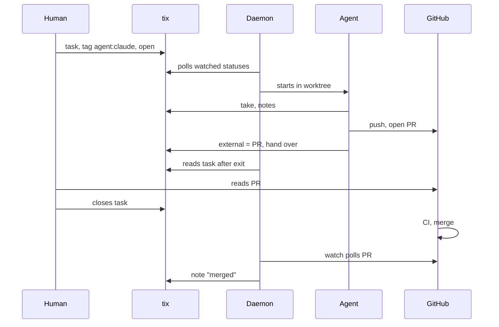

# tiny-symphony: process map

Draft for 0.2.0, 2026-11-12. One task from the board to `main`, across four systems: the tracker
(tix), the daemon, the git repository and GitHub. Who moves what, who writes where, what happens
when a step fails. Rules of each step: `docs/specs/0.2.0.md`. Facts about GitHub:
`docs/research/T-704-github-pr-flow.md`.

## Principles

1. **Each system owns its state.** The tracker owns the task and its status, git owns the branch,
   GitHub owns the PR, CI and the merge. The daemon owns nothing durable: it reads and nudges.
2. **The agent works like a person.** It takes the task in the tracker, writes its notes there,
   commits, pushes, opens the PR, puts its link into the task (`external`) and hands the task over.
   The same rules files as an interactive session.
3. **The human gates in the tracker.** Every human decision is a status move on the board. The
   human never has to open GitHub to move work on.
4. **The daemon writes only to say something went wrong.** A note, then a move to blocked (the
   agent keeps failing) or back to open (the run left the task taken, or the PR did not land). Each
   write follows a fresh read, so a human's move always wins.
5. **Modules are separate and can be turned off.** Dispatch is the core; PR watch and cleanup are
   switches in the config. With both off the daemon is a task launcher.

## Systems

| System | Owns | Written by | Read by the daemon with |
| --- | --- | --- | --- |
| tix | task, status, claim, notes, `external` | agent, human, daemon (note, blocked, open) | `tix list --json`, `tix show --json`, `tix projects` |
| daemon | running runs, retry times in memory; attempts file in the worktree | daemon | - |
| git repo | worktree `T-<N>-<slug>`, commits, branch | daemon (worktree add and remove), agent (commit, push) | `git worktree list` |
| GitHub | PR, CI, merge | agent (PR), GitHub (CI, merge), human (merge, review) | `gh pr view --json state,mergedAt,mergeStateStatus,statusCheckRollup` |

## Main path

The daemon talks to the tracker and GitHub only by polling; it writes nothing on this path except
the last note, and only with the watch on.

Statuses are names from the config; with tix 0.8 they are the five built-in ones. Watched statuses
(default `open`) are where an agent picks work up; every other status waits for a human.

| # | Who | System | What happens | Task status after |
| --- | --- | --- | --- | --- |
| 1 | human | tix | creates a task with criteria, tags it `agent:<name>`, puts it in a watched status | open |
| 2 | daemon | tix | sees it: watched status, tag, no live claim, not an epic, `After:` tasks closed | open |
| 3 | daemon | git | adds or reuses the worktree on branch `T-<N>-<slug>` | open |
| 4 | daemon | agent CLI | starts the agent in the worktree; the prompt names the actor `tiny-symphony:<agent>:<T-N>` | open |
| 5 | agent | tix | `tix take T-N --as <actor>` | in_progress |
| 6 | agent | git, GitHub | works, runs the project checks, commits, pushes, opens the PR | in_progress |
| 7 | agent | tix | `external` = PR link, a note, `tix move T-N <handoff_status>` (blocked "Ждёт: review PR" on 0.8, a review status on 0.9) | blocked or review |
| 8 | daemon | tix | after exit reads the task: out of the watched statuses and out of in_progress, so success | blocked or review |
| 9 | human | GitHub, tix | reads the PR from the link, then closes the task, or comments and moves it back to a watched status | closed or open |
| 10 | GitHub or human | GitHub | CI runs; the PR is merged (see Merge) | closed |
| 11 | daemon (watch) | GitHub, tix | closed task with a PR link: merged, so a note "merged <sha>" | closed |
| 12 | daemon (cleanup) | git | removes the worktree; `git branch -d` deletes the branch only if git sees it merged | closed |

A comment from the human in step 9 sends the task back to step 2: the same worktree and branch,
the agent reads the comments in `tix show`.

## When a step fails

| Step | Failure | Who sees it | What happens |
| --- | --- | --- | --- |
| 4-7 | agent crashed or timed out before `take` | daemon: task still in a watched status | failed attempt; retry after 1, 5, 15 min with the reason in the prompt |
| 5-7 | agent crashed, timed out or exited with the task still taken | daemon: in_progress with our claim | failed attempt; note, task back to open, retry |
| 7 | agent handed over and then exited with an error | daemon: task out of the watched statuses | success; the tracker state decides |
| 4-7 | the same task failed `max_attempts` times | daemon | note with the reason and log path, task to blocked, count reset; the human decides |
| 5 | another session holds the task | tix refuses `take` | the agent exits; the task stays in open with that claim and is skipped while the claim lives |
| 4-7 | the human removed the tag | daemon: next tick | run stopped, no attempt |
| 8 | the human moved the task between the run's end and the daemon's write | daemon: fresh read before writing | the daemon writes nothing |
| 7 | the agent closed the task itself | daemon: closed by our actor | success with a note "review skipped" (open question Q3) |
| 7 | no PR link in `external` | the watch skips the task | cleanup removes the worktree; the unmerged branch stays |
| 10 | a check failed or the PR conflicts after close | daemon (watch): `statusCheckRollup`, `mergeStateStatus` `DIRTY` | note with the reason, task back to open; the agent fixes it on the same branch; at most `max_reopens` times |
| 10 | PR closed without merge | daemon (watch): `state` `CLOSED`, no `mergedAt` | one note; the task stays closed, the branch stays |
| any | tix does not answer | daemon: CLI error or timeout | tick skipped, runs left alone |
| any | `gh` does not answer | daemon (watch) | log line, next round |
| any | daemon crashed | daemon on start: pid files | leftover agents killed, attempts kept in the worktree |

## Merge: variants, not decided

GitHub facts that shape this:

- Auto-merge is switched on per PR and waits only for the required checks and reviews of the base
  branch.
- `gh pr merge --auto` merges at once when the PR is already mergeable (CLEAN or UNSTABLE). With no
  required check on `main` that means at once, even with checks pending or red.
- The author of a PR cannot approve it, and the agent pushes as the owner, so required reviews do
  not work for one person.
- tarn, tix, famulus and ci-sandbox protect `main` with the required check `gate` and allow
  auto-merge. Private repositories on the free plan cannot have protection rules.
- Symphony forbids auto-merge for the same reason ("no required checks so auto-merge can skip
  tests"); its agent waits for green checks and merges with `gh pr merge --squash` itself.

| Variant | Who merges | Human gate | Needs |
| --- | --- | --- | --- |
| A. Agent at PR time | GitHub, after the agent runs `gh pr merge --auto` | none: the PR lands on green CI, before the human looks | a required check on `main` |
| B. Daemon at the human's gate | GitHub, after the daemon runs `gh pr merge --auto --match-head-commit <sha>` when the human moves the task to a merging status; where no required check exists, the daemon reads `statusCheckRollup` first | the status move | a required check, or the daemon's own check |
| C. Human | the human in GitHub | the merge button | nothing |

Until this is decided the watch only reports: it never switches auto-merge on and never merges
(boundary R7). B is the closest to Symphony's "Merging" status. Linear works the other way round:
the tracker follows PR events (opened, so In Progress; merged, so Done).

## Modules and switches

| Module | Config | Off means |
| --- | --- | --- |
| dispatch (core) | `tracker`, `watch`, `handoff_status`, `[agents.*]` | - |
| tracker adapter | `tracker = "tix"` | - (one adapter per tracker behind one interface) |
| PR watch | `[watch_pr] enabled`, `poll_minutes`, `max_reopens` | closed tasks are never checked against GitHub |
| cleanup | `[cleanup] enabled`, `log_days` | worktrees and logs stay until removed by hand |
| check | `tiny-symphony check` | - |
