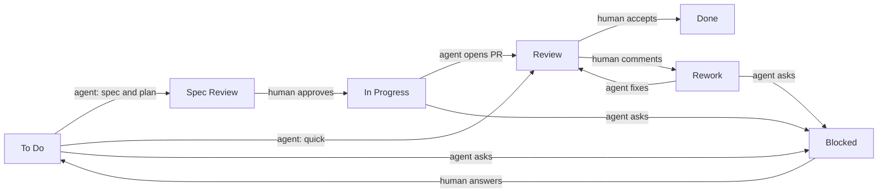

# tiny-symphony: spec

Status: accepted 2026-11-11, implemented in v0.0.1. Inspired by [OpenAI Symphony](https://github.com/openai/symphony)
([SPEC.md](https://github.com/openai/symphony/blob/main/SPEC.md), read at `be10a1b`).

tiny-symphony is a small daemon that watches a task tracker, takes the tasks marked for an agent
and runs that agent on each task in its own git worktree. It is the supervisor of those runs: it
hands out tasks, checks that each agent finished and returned an honest result, and cleans up after
it. It does no work on the task itself.

## Philosophy

1. **One job.** Take a task, hand it to an agent, keep it in its own workspace. Not a tracker, not
   a board, not a CI bot, not a merge bot. The board is the tracker's; merging is the human's.
2. **The tracker is the state.** No database. A restart reads the tracker again and carries on.
   In-memory state (running runs, attempt counts) may be lost; nothing else is.
3. **An agent is a command.** Each agent is an argv template in the config. A new agent is a few
   lines of config, no code. The daemon does not parse agent output: it sees the exit code and the
   result file.
4. **The agent does not know the tracker.** The daemon puts the task into the prompt and applies
   the agent's result to the tracker. Agents need no tracker access and no tracker credentials, so
   any agent and any sandbox work, and swapping the tracker touches only the daemon.
5. **Humans gate by doing nothing.** A gate is a status the daemon does not watch. The task waits
   there until a human moves it on. There is no special handoff logic.
6. **Small and boring.** One static binary, stdlib first, a dependency only when stdlib is painful.
   A feature is added when its absence hurts in real use, not before.

## Pipeline

Statuses are the Backlog.md ones. The daemon watches the active statuses and only tasks that carry
an `agent:<name>` label; a task without that label belongs to a human or an interactive session.

| Status | Who | What happens | Next |
| --- | --- | --- | --- |
| To Do | agent | reads the task, writes a spec and plan; with label `quick` it skips the spec and does the work | Spec Review, or Review for `quick`, or Blocked |
| Spec Review | human | checks and edits the spec and plan | In Progress |
| In Progress | agent | implements in the worktree, pushes the branch, opens a PR or MR | Review, or Blocked |
| Review | human | checks the result | Done, or Rework with a comment |
| Rework | agent | reads the review comments, fixes, pushes | Review, or Blocked |
| Blocked | human | answers the agent's question in a comment | the status the task came from |
| Done | - | the daemon removes the worktree | - |



Agent statuses run a run; human statuses wait. Source: the pipeline table above.

The human's original drawing is `docs/flow.drawio`. One difference: there an agent question moves
the task to Review; here it moves to Blocked, so Review always means "a result is ready".

## Loop

Every `poll_seconds`:

1. **Reconcile.** For each running run, read the task status and the run time; stop runs as the
   Supervision table says. Stopping is SIGTERM to the process group, SIGKILL after 10 s.
2. **Collect.** List tasks in the active statuses with an `agent:<name>` label whose dependencies
   are all Done. Order: priority, then oldest, then id. Statuses and labels are compared trimmed
   and lowercased.
3. **Dispatch** while fewer than `max_agents` runs are going and the task is not already running.

One goroutine owns the scheduler state (running runs, attempts, retry times); workers only report
their outcome back on a channel. Failure classes: a bad config stops dispatch but reconcile goes on;
a tracker read error skips the tick and leaves the runs alone. Logs are `key=value` lines
(`log/slog`) with the task id and the outcome.

A run:

1. Prepare the workspace: `git worktree add` from the task project's repo on branch `T-<N>-<slug>`,
   or reuse the existing worktree of that task (the same worktree serves To Do, In Progress and
   Rework).
2. Render the prompt for the status from `prompts/<status>.md` with the task in it. The template
   is strict (Go `text/template`, `missingkey=error`): an unknown variable fails the run. Besides
   the task fields it gets `attempt` and `last_error`.
3. Start the agent in the worktree in its own process group, output to a log file, pid to
   `.tiny-symphony/pid`.
4. On exit, check the result (see Supervision). A good result is applied to the tracker; anything
   else is a failed attempt.

## Supervision

The daemon does not trust the agent's word; it checks facts it can see itself.

| ID | Failure | How the daemon sees it | What it does |
| --- | --- | --- | --- |
| S1 | agent crashed | non-zero exit or killed by a signal | failed attempt |
| S2 | agent hung | `run_timeout` passed | kills the process group, failed attempt |
| S3 | task moved by a human | status differs from the one the run started in | kills the process group, no attempt counted |
| S4 | no or bad result | `result.json` missing, not valid, a transition not in the pipeline table, or Blocked without a comment | failed attempt |
| S5 | spec not written | To Do result without a plan (unless `quick`) | failed attempt |
| S6 | work not finished | result Review, but the worktree has uncommitted changes, the branch is not pushed, no PR or MR exists for it, or the project's `verify` command fails | failed attempt |
| S7 | agent keeps failing | `max_attempts` failed attempts on one task | comments with the reason and log path, moves the task to Blocked |
| S8 | daemon restarted | a pid file in a worktree with that process still alive | kills the leftover process group, then dispatches as usual |

Failed attempts are retried with backoff (1, 5, 15 min); the reason of the last failure goes into
the next prompt, so the agent knows what to fix.

Cleanup:

- The whole process group is killed when a run ends or is stopped, so no agent children stay.
- `.tiny-symphony/` is outside git (`info/exclude`); the agent's other leftovers count as
  uncommitted changes and fail the check above.
- When a task is Done, its worktree is removed, and its local branch is deleted if it is merged
  (`git branch -d`, which refuses unmerged branches).
- Run logs older than `log_days` are deleted.

On start the daemon takes a lock file so that two daemons never run at once, and does the Done
cleanup.

## Agent contract

The agent gets one prompt and a working directory. Before it exits it writes
`.tiny-symphony/result.json` in the worktree:

```json
{"status": "Spec Review", "plan": "markdown", "notes": "markdown", "summary": "markdown",
 "checked_ac": [1, 2], "comment": "a question to the human"}
```

Only `status` is required. The daemon accepts only the transitions in the pipeline table for the
status the run started in. The result maps to task fields, not to a pile of comments: `plan` to
`backlog task edit --plan`, `notes` to `--append-notes`, `summary` to `--final-summary`,
`checked_ac` to `--check-ac`; `comment` is only for a question to the human (Blocked). The status
is written last. The agent pushes its own branch and opens its own PR or MR (it needs `git` and
`gh` or `glab` for that); the PR link goes into `notes`. The prompts name the task's acceptance
criteria as the bar: the agent runs them before it hands the task over.

## Config

One file, `~/.config/tiny-symphony/config.toml`, plus prompt files next to it.

```toml
backlog_dir = "~/Dev/backlog"
workspace_root = "~/.local/share/tiny-symphony/work"
poll_seconds = 30
max_agents = 2
run_timeout_minutes = 60
max_attempts = 3
log_days = 14

[projects.tix]        # Backlog.md project -> git repository
repo = "~/Dev/self-projects/tracker"
verify = "make check" # optional, runs in the worktree before a result goes to Review
forge = "github"      # optional: github (gh) or gitlab (glab); default from the remote host

[agents.claude]
cmd = ["claude", "-p", "--permission-mode", "auto", "{prompt}"]
[agents.codex]
cmd = ["codex", "exec", "--sandbox", "workspace-write", "{prompt}"]
[agents.kimi]
cmd = ["kimi", "-p", "{prompt}"]
```

`backlog_dir` and `workspace_root` are required; the other settings default to the values above. At least one agent and one project are needed to do any work. `~` is expanded in path fields only. `{prompt}` is replaced by the rendered prompt as one argv element; no shell is involved.
Each command above passed `make smoke AGENT=<name>` on 2026-11-11: the task reached Spec Review with a plan
(claude 2.1.322, codex 0.167.1, kimi 2.5.2). Codex writes `.tiny-symphony/result.json` under
`--sandbox workspace-write`. Kimi `--auto` and `-y` do not work with `-p`, which already runs without asking.

Not verified (flags from `--help` on 2026-11-11, no passing smoke run; the first two stopped on
credentials, not on flags):

```toml
# opencode 2.2.6: the key in the local setup had expired
cmd = ["opencode", "run", "--auto", "{prompt}"]
# pi 1.4.0: no API key configured
cmd = ["pi", "-p", "{prompt}"]
```

A task with no `[projects]` entry is skipped with a log
line.

## Commands

| Command | What it does |
| --- | --- |
| `tiny-symphony run` | the loop, in the foreground; launchd or systemd keep it alive |
| `tiny-symphony run --once` | one tick, then waits for its runs and exits; exit 1 if a run failed |
| `tiny-symphony check` | one line per check, exit 1 on any FAIL; starts no agent, writes and creates nothing |

Both take `--config <path>` (default `~/.config/tiny-symphony/config.toml`). `check` tests: the tracker answers, `workspace_root` (or its nearest existing parent) is a writable directory, at least one agent and one project exist, each agent command is on PATH and contains `{prompt}`, each repo is a git repo with `git` and the forge CLI (chosen as in S6) on PATH, and the three prompt files render.

## Trust and safety

Single user, own machine, tasks written by that user. Agents run without approval prompts, bounded
by their worktree and by their own sandbox where they have one. A task text is a prompt, so anyone
who can write tasks can run code; do not point the daemon at a tracker others write to.

## Taken from Symphony

Poll loop with bounded concurrency; one workspace per task, reused across runs; stop a run when its
task changes status; retry with backoff; restart recovery from the tracker without a database;
handoff to a human as a status; a normalized task as the one seam to the tracker; candidate order;
strict prompt templates with `attempt`; one owner of the scheduler state; failure classes;
`key=value` logs; one workpad per task (result to fields); acceptance criteria as the bar; smoke
tests against the real agent CLIs. The full table: `docs/research/T-660-prior-art.md`.

## Left out

Web UI and HTTP API (the Backlog.md board is the UI); database; hooks; per-state concurrency;
multi-turn sessions inside one run (the next status is the next run); stall detection by output
(one-shot agents stay silent until they finish, so silence means nothing; `run_timeout` covers
hangs); token and cost accounting; CI and PR reactions; auto-merge; trackers other than Backlog.md;
live config reload (restart the daemon); a per-project `setup` command and a `followups` result
field (both wait for real need); a daemon mode of its own.

## Boundaries

What the daemon never does, whatever the input. Each line gets a test.

- R1: Starts an agent outside `workspace_root`, or with a cwd other than the task's worktree.
- R2: Touches a task without an `agent:<name>` label.
- R3: Applies a transition that is not in the pipeline table for the status the run started in.
- R6: Runs a second instance against the same `workspace_root`.
- R7: Merges or pushes, or deletes an unmerged branch. It removes only worktrees of Done tasks.
- R4: Applies a result it has not checked.
- R5: Passes the prompt through a shell.

A line gets its ID together with its test.

## Decisions

- D1 Go, one binary. Rejected: Rust. The daemon waits on agents that run for minutes, so speed and
  memory do not matter; Go has `os/exec`, signals, JSON and templates in stdlib, and the author's
  other tools are Go. Affects: nothing outside the repo.
- D2 TOML config, the only planned dependency (`github.com/BurntSushi/toml`, MIT). Rejected: JSON
  (no comments), YAML (bigger dependency). Affects: the config format users write.
- D3 The daemon is the only tracker writer; the agent returns a result file (philosophy 4).
  Rejected: the agent calls the `backlog` CLI itself, which needs write access outside the worktree
  and breaks under sandboxes such as `codex --sandbox workspace-write`. Symphony takes a third way,
  tracker tools served by the orchestrator. Affects: every prompt and the agent contract; a new
  tracker needs only a new reader and writer in the daemon.

## Open questions

- Q1 Tasks without code (research, writing): a plain folder instead of a worktree, or not in v0.
- Q2 Subscription limits: an agent that hits its limit fails on every task. A pause for that agent
  after N failures in a row across tasks would save attempts; the daemon cannot tell a limit from
  other failures without parsing output.
